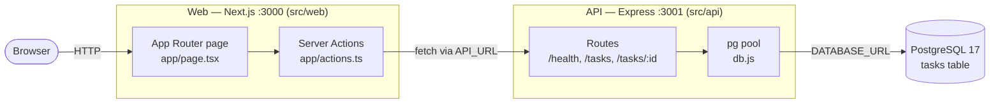
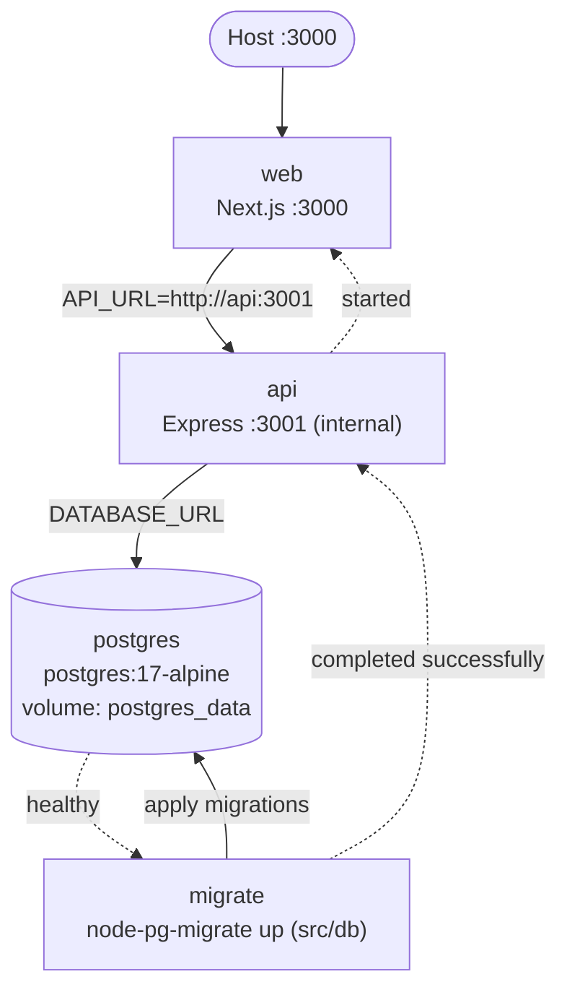
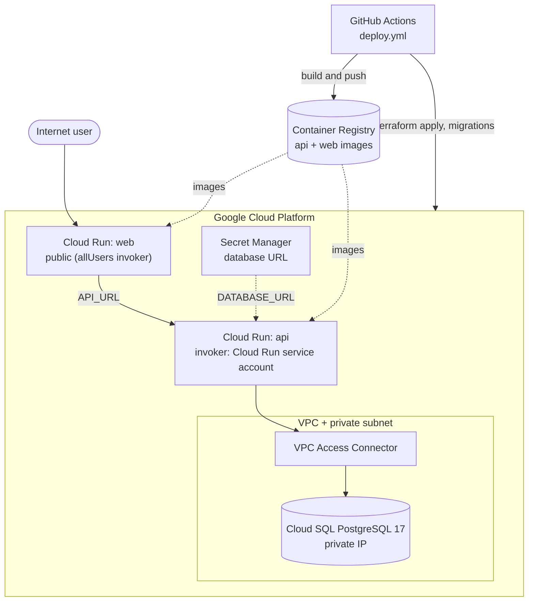

# Architecture

P-Forge is a three-tier task manager: Next.js frontend, Express REST API, PostgreSQL database.
The diagrams are Mermaid and render on GitHub.

## Request flow

## Local deployment (Docker Compose)

Dotted arrows show `depends_on` startup order.

## Production deployment (GCP, Terraform)

Infrastructure is defined in `src/infrastructure/main.tf`. The wiki's architecture page is the source for the CI/CD and
Cloud Run/Cloud SQL description; the Terraform details above were checked only partially in `main.tf`, so verify against it
before relying on exact wiring.
